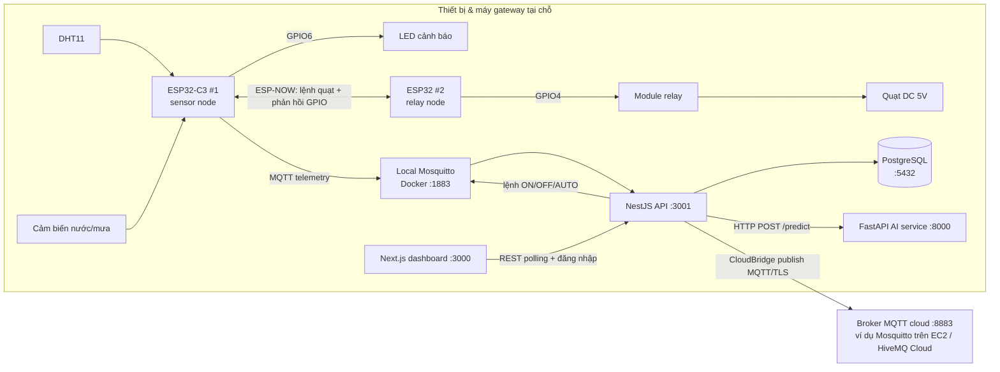
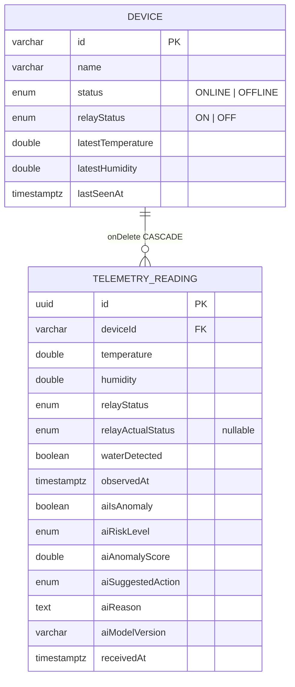

# IoT Environmental Monitoring — Paper Warehouse

> Hệ thống giám sát nhiệt độ, độ ẩm và cảm biến nước cho kho giấy bằng ESP32, MQTT, NestJS, PostgreSQL và dashboard Next.js — kèm phát hiện bất thường bằng AI (Isolation Forest) và điều khiển quạt qua relay.

Hồ sơ đồ án IoT sử dụng phần cứng ESP32 thật. Toàn bộ backend, dashboard và AI service chạy local bằng Docker Compose + npm workspaces; firmware được nạp bằng Arduino IDE.

---

## 📖 Giới thiệu

**Vấn đề:** Kho giấy cần theo dõi liên tục nhiệt độ, độ ẩm và dấu hiệu ướt/nước. Nếu môi trường vượt ngưỡng, hàng hóa dễ hư hỏng; hệ thống cần cảnh báo sớm và có thể bật quạt thông gió từ xa.

**Hệ thống làm gì:**

- Hai board ESP32 xử lý cảm biến và relay **tại chỗ** (không cần cloud để điều khiển).
- Dữ liệu đi qua **MQTT** tới backend **NestJS**, được lưu vào **PostgreSQL**, chấm điểm bất thường bằng **dịch vụ AI Python** riêng.
- **Dashboard Next.js** hiển thị dữ liệu gần realtime và cho phép admin gửi lệnh Bật/Tắt/Tự động cho quạt.
- **CloudBridge** (module trong NestJS) *tùy chọn* đẩy bản sao telemetry đã xử lý lên broker MQTT cloud để xem từ xa.

**Đối tượng sử dụng:** sinh viên/đội ngũ làm đồ án IoT, người vận hành kho muốn demo giám sát môi trường bằng phần cứng thật.

> ⚠️ DHT11 là cảm biến mức học tập — số đo có độ chính xác giới hạn, không thay thế thiết bị đo công nghiệp.

---

## ✨ Tính năng

**Phần cứng (firmware)**

- ESP32-C3 #1 (sensor node): đọc DHT11 (GPIO4) + cảm biến nước/mưa số (GPIO5, active-low), bật LED cảnh báo (GPIO6) khi phát hiện nước.
- Logic tự động bật/tắt quạt với hysteresis: **ON khi ≥30°C hoặc ≥75% RH**, **OFF khi ≤28°C *và* ≤70% RH**.
- Điều khiển 2 ESP32 bằng **ESP-NOW** trực tiếp (không qua router): #1 gửi lệnh quạt, #2 phản hồi mức GPIO relay.
- ESP32 #2 (relay node): điều khiển relay qua GPIO4 (active-high), failsafe tự tắt relay khi mất ESP-NOW quá 10 giây.
- Sketch test relay độc lập (`firmware/relay-module-test`) để kiểm tra cực tính relay không cần Wi-Fi.
- Gửi telemetry MQTT ~2 giây/lần; khi mất Wi-Fi vẫn giữ chức năng cảm biến + ESP-NOW (MQTT bị tắt, fallback kênh 1).

**Backend NestJS (`apps/api`)**

- Nhận telemetry MQTT (subscribe `iot/devices/+/telemetry`), validate payload bằng `class-validator`; payload sai bị bỏ qua.
- **Heartbeat/online-offline**: telemetry được coi là heartbeat; cron mỗi 5 giây đánh dấu thiết bị `OFFLINE` khi quá `DEVICE_OFFLINE_AFTER_SECONDS` (mặc định 15 giây).
- Lưu lịch sử telemetry kèm kết quả AI vào PostgreSQL.
- **Cảnh báo ngưỡng**: `HIGH_TEMPERATURE` (mặc định ≥35°C) và `HIGH_HUMIDITY` (≥80%), cấu hình qua env.
- **Điều khiển relay** `ON`/`OFF`/`AUTO` qua REST → publish MQTT QoS 1 lên `iot/devices/{deviceId}/control` (chỉ vai trò `admin`).
- **AI integration**: gọi `POST /predict` của FastAPI cho mỗi reading; nếu AI không sẵn sàng, telemetry **vẫn được lưu** với `riskLevel=unavailable`.
- **CloudBridge** (tùy chọn): publish reading đã qua AI + trạng thái gateway lên broker cloud qua MQTT/TLS.
- **Auth**: đăng nhập theo session cookie HMAC-SHA256 (TTL 8 giờ, HttpOnly, SameSite=Lax), hai vai trò `admin`/`user`, guard áp dụng toàn cục.

**Dashboard Next.js (`apps/dashboard`)**

- Trang đăng nhập `/login`; `AuthGate` kiểm tra phiên trước khi vào ứng dụng; nút đăng xuất ở topbar.
- Route `/dashboard`: hiển thị **chỉ dữ liệu thật** từ API. Route `/monitor`: dữ liệu thật, fallback **dữ liệu mô phỏng** khi API chưa có reading (nhãn "Preview").
- Polling `GET /dashboard/overview` mỗi ~3 giây — không dùng WebSocket.
- Thành phần: metric tiles, biểu đồ xu hướng nhiệt độ/độ ẩm (Recharts), biểu đồ **AI anomaly percentile**, danh sách cảm biến kèm vùng ngưỡng (Normal/Watch/Alert), lịch sử reading, danh sách alert, chuyển đổi thiết bị.
- Nút **Bật/Tắt/Tự động** điều khiển quạt (chỉ admin, chỉ khi thiết bị ONLINE và đang xem dữ liệu thật).

**AI service (`apps/ai-service`)**

- FastAPI phục vụ mô hình **Isolation Forest** (scikit-learn) học baseline nhiệt độ/độ ẩm từ dữ liệu kho *khô*.
- Quy tắc cứng: phát hiện nước → trả về `critical` ngay lập tức (không dùng model).
- Huấn luyện (`train_model`) và đánh giá (`evaluate_model`) bằng CLI trên CSV; artifact `models/environment-isolation-forest.joblib` do người dùng tự tạo (không commit).
- `GET /health` báo `degraded` khi chưa có mô hình; `POST /predict` trả 503 khi chưa train.

---

## 🛠️ Công nghệ sử dụng

| Thành phần | Công nghệ |
| --- | --- |
| Firmware | Arduino C/C++, ESP32-C3 + ESP32, DHT11 (Adafruit DHT lib), cảm biến mưa/nước digital, module relay 5V, ESP-NOW, WiFi, PubSubClient |
| Backend | NestJS 10, TypeORM 0.3, PostgreSQL 16, `mqtt` (mqtt.js), `@nestjs/schedule`, `@nestjs/axios`, `class-validator`/`class-transformer` |
| AI service | Python, FastAPI, Pydantic 2, scikit-learn (Isolation Forest), joblib, uvicorn |
| Dashboard | Next.js 15 (App Router), React 19, TypeScript, Tailwind CSS 3.4, component shadcn-style local (`components/ui`), Radix UI (`react-slot`), Recharts, lucide-react, date-fns, `class-variance-authority`/`tailwind-merge` |
| Hạ tầng | Docker Compose (PostgreSQL 16-alpine, Eclipse Mosquitto 2, AI service), broker MQTT cloud tùy chọn (HiveMQ Cloud hoặc Mosquitto trên EC2) |
| Công cụ | npm workspaces, concurrently, ESLint, Prettier |

---

## 🏗️ Kiến trúc hệ thống



Hai hướng dữ liệu riêng biệt:

- **Telemetry:** ESP32-C3 #1 → broker local → NestJS (cập nhật thiết bị → gọi AI → lưu reading → đánh giá alert → CloudBridge) → dashboard đọc qua REST.
- **Lệnh tay:** Dashboard → `POST /devices/{id}/control/relay` → broker local → ESP32-C3 #1 → ESP-NOW → ESP32 #2 → relay → quạt.

Dashboard **không** kết nối trực tiếp tới ESP32 hay MQTT broker. CloudBridge **không** điều khiển relay và **không** mirror traffic thô — chỉ đẩy payload đã chuẩn hóa (`gatewayId`, `telemetryId`, số đo, kết quả AI…).

---

## 📂 Cấu trúc thư mục

```txt
.
├── apps/
│   ├── api/                      # Backend NestJS (cổng 3001)
│   │   └── src/
│   │       ├── common/           # Enum (relay, alert, ai risk...) và util chung
│   │       ├── config/           # (placeholder theo cấu trúc mục tiêu)
│   │       ├── database/         # Module TypeORM (PostgreSQL)
│   │       └── features/         # Feature module theo miền
│   │           ├── auth/         # Đăng nhập, session cookie, AuthGuard, @Public/@Roles
│   │           ├── mqtt/         # Kết nối broker local, parse payload, publish lệnh relay
│   │           ├── telemetry/    # Lưu & truy vấn reading, entity telemetry_readings
│   │           ├── devices/      # Thiết bị, heartbeat monitor (cron 5s)
│   │           ├── automation/   # Quy tắc ngưỡng nhiệt độ/độ ẩm
│   │           ├── alerts/       # Entity + API cảnh báo
│   │           ├── ai/           # HTTP client gọi FastAPI /predict
│   │           ├── cloud-bridge/ # Publish telemetry đã xử lý lên broker cloud
│   │           └── dashboard/    # API tổng quan cho UI
│   ├── dashboard/                # Next.js dashboard (cổng 3000)
│   │   └── src/
│   │       ├── app/              # Route: /login, /dashboard (live), /monitor (preview)
│   │       ├── components/ui/    # Button, Card, Badge, MetricCard (shadcn-style)
│   │       ├── features/
│   │       │   ├── auth/         # AuthGate kiểm tra phiên phía client
│   │       │   ├── dashboard/    # API client, types, server action điều khiển relay
│   │       │   └── linear-monitor/ # Component dashboard: charts, sensor rows, fan control, mock
│   │       └── lib/              # api-client, utils (cn)
│   └── ai-service/               # FastAPI AI (cổng 8000)
│       ├── src/
│       │   ├── main.py           # /health và /predict
│       │   ├── schemas.py        # Pydantic request/response
│       │   ├── settings.py       # Cấu hình (env prefix AI_)
│       │   └── services/         # predictor, train_model (CLI), evaluate_model (CLI)
│       ├── warehouse-baseline.csv # Dữ liệu baseline đã review để huấn luyện
│       └── requirements.txt
├── firmware/
│   ├── esp32-c3-sensor-node/     # Sketch ESP32 #1 (cảm biến + MQTT + ESP-NOW)
│   ├── esp32-relay-node/         # Sketch ESP32 #2 (relay + ESP-NOW)
│   └── relay-module-test/        # Sketch test relay độc lập
├── infra/mosquitto/              # mosquitto.conf cho broker local trong Docker
├── docs/                         # system-architecture, mqtt-topic-tree, broker-cloud/setup
├── docker-compose.yml            # PostgreSQL + Mosquitto + AI service
└── package.json                  # npm workspaces + script dev/build/lint
```

---

## ⚙️ Yêu cầu môi trường

| Thành phần | Yêu cầu |
| --- | --- |
| Docker | Docker Desktop (hoặc Docker Engine + Compose plugin) — chạy PostgreSQL, Mosquitto, AI service |
| Node.js | 18.18+ (yêu cầu của Next.js 15; khuyến nghị 20 LTS) — [CẦN BỔ SUNG: không có `engines` trong package.json] |
| Python | 3.10+ (code AI dùng cú pháp `str \| None` ở runtime) |
| npm | Có hỗ trợ workspaces (npm 7+) |
| Arduino IDE | Board **ESP32C3 Dev Module**, thư viện **DHT sensor library by Adafruit**, **Adafruit Unified Sensor**, **PubSubClient** |
| Phần cứng | 2× ESP32/ESP32-C3, DHT11, cảm biến mưa/nước digital, module relay 5V, LED + điện trở 220–1000Ω, quạt DC 5V |

---

## 🚀 Cài đặt và chạy

### 1. Clone và cài dependency

```bash
git clone <repo-url>
cd <repo>
npm install
```

### 2. Cấu hình môi trường

```bash
cp apps/api/.env.example apps/api/.env
cp apps/dashboard/.env.example apps/dashboard/.env
```

Sửa `apps/api/.env` (xem mục 🔐 Cấu hình). **Lưu ý:** file `.env.example` có dòng `[TEMPLATE]` ở đầu — xóa dòng này khi copy sang `.env`.

### 3. Khởi động hạ tầng (PostgreSQL + Mosquitto + AI service)

```bash
docker compose up -d
docker compose ps   # kiểm tra cả 3 service đang healthy
```

- PostgreSQL: `localhost:5432`
- Mosquitto (broker MQTT local): `localhost:1883`
- AI service: `localhost:8000`

### 4. Huấn luyện model AI (khuyến nghị trước khi demo)

Repo **không** kèm model sẵn; phải train từ dữ liệu baseline. File mẫu `apps/ai-service/warehouse-baseline.csv` (~1180 reading đã review) có sẵn để thử.

```bash
cd apps/ai-service
python -m venv .venv
# macOS/Linux:
source .venv/bin/activate
# Windows PowerShell:
# .venv\Scripts\Activate.ps1
pip install -r requirements.txt
python -m src.services.train_model warehouse-baseline.csv
cd ../..
```

Artifact được ghi vào `apps/ai-service/models/environment-isolation-forest.joblib`. Khi chạy AI service bằng Docker, mount thư mục `apps/ai-service/models` vào container — sau khi train, khởi động lại:

```bash
docker compose up -d --build ai-service
```

Kiểm tra: `GET http://localhost:8000/health` → `model_ready: true`.

### 5. Chạy backend + dashboard

```bash
npm run dev
```

Hoặc chạy từng phần:

```bash
npm run dev:api     # NestJS        → http://localhost:3001
npm run dev:dashboard  # Next.js    → http://localhost:3000
npm run dev:ai      # FastAPI local → http://localhost:8000 (nếu không dùng Docker cho AI)
```

Mở `http://localhost:3000` → chuyển hướng `/login` → đăng nhập bằng tài khoản đã cấu hình ở `apps/api/.env`.

### 6. (Tùy chọn) Nạp firmware cho ESP32

1. Copy `firmware/esp32-c3-sensor-node/secrets.h.example` → `secrets.h`, điền Wi-Fi 2.4 GHz và `MQTT_HOST` (**IP LAN của máy chạy Docker/Mosquitto**, không phải IP public). Tương tự cho `firmware/esp32-relay-node/secrets.h`. Không commit `secrets.h`.
2. Chọn board, nạp `esp32-c3-sensor-node.ino` cho ESP32 #1 và `esp32-relay-node.ino` cho ESP32 #2; Serial Monitor 115200 baud.
3. Không có phần cứng? Dashboard vẫn chạy với dữ liệu thật từ API (nếu có) hoặc dữ liệu mô phỏng ở route `/monitor`.

---

## 🔐 Cấu hình

### `apps/api/.env`

| Biến | Mô tả | Mặc định trong `.env.example` |
| --- | --- | --- |
| `PORT` | Cổng NestJS | `3001` |
| `CORS_ORIGIN` | Origin được phép gọi API (dashboard) | `http://localhost:3000` |
| `DATABASE_HOST` / `DATABASE_PORT` / `DATABASE_USER` / `DATABASE_PASSWORD` / `DATABASE_NAME` | Kết nối PostgreSQL | `localhost` / `5432` / `iot_user` / `iot_password` / `iot_monitor` |
| `DATABASE_SYNC` | TypeORM `synchronize` (tự sync schema) | `true` |
| `MQTT_URL` | Broker MQTT local | `mqtt://localhost:1883` |
| `MQTT_TELEMETRY_TOPIC` | Filter subscribe telemetry | `iot/devices/+/telemetry` |
| `TEMPERATURE_ALERT_THRESHOLD` | Ngưỡng alert nhiệt độ (°C) | `35` |
| `HUMIDITY_ALERT_THRESHOLD` | Ngưỡng alert độ ẩm (%) | `80` |
| `DEVICE_OFFLINE_AFTER_SECONDS` | Thời gian không telemetry → OFFLINE | `15` |
| `AI_SERVICE_URL` / `AI_SERVICE_TIMEOUT_MS` | Địa chỉ và timeout AI service | `http://localhost:8000` / `1500` |
| `AUTH_ADMIN_USERNAME` / `AUTH_ADMIN_PASSWORD` | Tài khoản admin | `admin` / *(placeholder)* |
| `AUTH_USER_USERNAME` / `AUTH_USER_PASSWORD` | Tài khoản user (chỉ xem) | `viewer` / *(placeholder)* |
| `AUTH_SESSION_SECRET` | Bí mật ký session cookie — **tối thiểu 32 ký tự** | *(placeholder)* |
| `AUTH_COOKIE_SECURE` | Đặt flag `Secure` cho cookie (bật khi chạy HTTPS) | `false` |
| `GATEWAY_ID` | ID gateway khi đẩy lên cloud | `edge-gateway-001` |
| `CLOUD_MQTT_ENABLED` | Bật/tắt CloudBridge | `false` |
| `CLOUD_MQTT_URL` / `CLOUD_MQTT_USERNAME` / `CLOUD_MQTT_PASSWORD` / `CLOUD_MQTT_CLIENT_ID` / `CLOUD_MQTT_RECONNECT_MS` | Kết nối broker cloud (ví dụ `mqtts://…:8883`) | *(placeholder)* |

**Bắt buộc trước khi chạy:** đặt `AUTH_ADMIN_PASSWORD`, `AUTH_USER_PASSWORD` khác nhau và `AUTH_SESSION_SECRET` ≥32 ký tự — nếu không, module auth từ chối hoạt động (HTTP 503). Hai username phải khác nhau.

### `apps/dashboard/.env`

| Biến | Mô tả | Mặc định |
| --- | --- | --- |
| `NEXT_PUBLIC_API_BASE_URL` | Địa chỉ NestJS API | `http://localhost:3001` |

### `firmware/*/secrets.h`

- `WIFI_SSID` / `WIFI_PASSWORD`: mạng 2.4 GHz (cả hai board phải cùng mạng để ESP-NOW dùng chung kênh).
- `MQTT_HOST` / `MQTT_PORT` / `MQTT_USERNAME` / `MQTT_PASSWORD`, `DEVICE_ID`: máy chạy broker local và mã thiết bị (mặc định `esp32_001`).

> Không commit `.env` hay `secrets.h` (đã có trong `.gitignore`). Không đưa secret thật vào README hay Git.

---

## 🗄️ Database

**PostgreSQL** — database `iot_monitor` (tạo sẵn bởi `docker-compose` qua `POSTGRES_DB`). Schema do TypeORM tự đồng bộ khi `DATABASE_SYNC=true` — **dự án chưa có migration script**; trước khi lên môi trường production-style cần thay bằng migrations.



Bảng thứ ba — **`alerts`**: `id (uuid)`, `deviceId`, `severity (INFO|WARNING|CRITICAL)`, `code` (ví dụ `HIGH_TEMPERATURE`, `HIGH_HUMIDITY`), `message`, `createdAt`. Alert lưu theo `deviceId` dạng chuỗi, **không** khóa ngoại tới `devices`.

Quan hệ/chi tiết đáng chú ý:

- Một thiết bị có nhiều reading; xóa device sẽ xóa các reading liên quan (CASCADE).
- `relayStatus` là *lệnh* quạt; `relayActualStatus` là mức GPIO phản hồi từ ESP32 #2 (có thể `null` khi chưa có feedback) — không xác nhận tiếp điểm relay đã đóng.
- Kết quả AI (`aiIsAnomaly`, `aiRiskLevel`, `aiAnomalyScore`, `aiSuggestedAction`, `aiReason`, `aiModelVersion`) được ghi ngay trên mỗi reading.

---

## 🔌 API

Tất cả endpoint (trừ `auth/login`, `auth/logout`) yêu cầu session cookie hợp lệ (`iot_session`) sau khi đăng nhập. Request fetch từ dashboard dùng `credentials: 'include'`.

### Backend NestJS (`http://localhost:3001`)

| Method | Endpoint | Quyền | Mô tả |
| --- | --- | --- | --- |
| POST | `/auth/login` | Public | Đăng nhập; body `{ "username": "...", "password": "..." }` → `{ "authenticated": true, "username", "role" }` + cookie `iot_session` |
| POST | `/auth/logout` | Public | Xóa session (xóa cookie) → `{ "authenticated": false }` |
| GET | `/auth/session` | Đăng nhập | Trả `{ "authenticated": true, "username", "role" }`; 401 nếu chưa đăng nhập |
| GET | `/dashboard/overview` | Đăng nhập | Tổng quan: `summary` (totalDevices, onlineDevices, activeAlerts), `devices`, `latestReadings` (20), `latestAlerts` (10) |
| GET | `/devices` | Đăng nhập | Danh sách thiết bị |
| GET | `/devices/:deviceId` | Đăng nhập | Một thiết bị (hoặc `null` nếu không có) |
| GET | `/telemetry?limit=50` | Đăng nhập | Reading mới nhất toàn hệ thống |
| GET | `/telemetry/devices/:deviceId?limit=100` | Đăng nhập | Reading theo thiết bị |
| GET | `/alerts?limit=30` | Đăng nhập | Alert mới nhất |
| POST | `/devices/:deviceId/control/relay` | **admin** | body `{ "relayStatus": "ON" \| "OFF" \| "AUTO" }` → `{ "deviceId", "relayStatus", "queued": true }` |

Ví dụ điều khiển relay:

```bash
curl -X POST http://localhost:3001/devices/esp32_001/control/relay \
  -H "Content-Type: application/json" \
  -b "iot_session=<token từ lúc đăng nhập>" \
  -d '{"relayStatus":"ON"}'
```

`queued: true` chỉ nghĩa broker MQTT đã nhận publish (QoS 1) — **chưa** xác nhận ESP32 đã xử lý; cần xem telemetry/serial tiếp theo để xác nhận.

### AI service (`http://localhost:8000`)

| Method | Endpoint | Mô tả |
| --- | --- | --- |
| GET | `/health` | `{ status, service, model_ready, model_version }` — `status: "degraded"` khi chưa train model |
| POST | `/predict` | Chấm điểm một reading — 503 khi chưa có model (trừ khi `water_detected=true`) |

Request/response `POST /predict`:

```json
{
  "device_id": "esp32_001",
  "temperature": 29.3,
  "humidity": 56,
  "water_detected": false,
  "relay_status": "OFF",
  "observed_at": "2026-10-03T08:00:00.000Z"
}
```

```json
{
  "is_anomaly": false,
  "risk_level": "normal",
  "anomaly_score": 0.31,
  "suggested_action": "NONE",
  "reason": "Reading is consistent with the learned dry-warehouse baseline.",
  "model_version": "..."
}
```

### MQTT topic

| Topic | Hướng | Mô tả |
| --- | --- | --- |
| `iot/devices/{deviceId}/telemetry` | ESP32-C3 #1 → broker local → NestJS | QoS 0, không retain, ~2 giây/lần |
| `iot/devices/{deviceId}/control` | NestJS → ESP32-C3 #1 | Payload chuỗi `ON`/`OFF`/`AUTO`, QoS 1, không retain |
| `cloud/iot/devices/{deviceId}/telemetry` | CloudBridge (trong NestJS) → broker cloud | Payload JSON đã chuẩn hóa gồm `schemaVersion`, `gatewayId`, `telemetryId`, số đo, relay, water, timestamps, object `ai` |
| `cloud/iot/gateways/{gatewayId}/status` | CloudBridge → broker cloud | Trạng thái gateway (`ONLINE`), QoS 1, retain |

Payload telemetry hiện tại:

```json
{
  "temperature": 29.7,
  "humidity": 54.6,
  "relayStatus": "ON",
  "relayActualStatus": "ON",
  "waterDetected": false
}
```

---

## 🖼️ Giao diện

<!-- Thêm screenshot của project tại đây -->

- `http://localhost:3000/login` — trang đăng nhập (dark theme, thương hiệu "Paper Warehouse").
- `http://localhost:3000/dashboard` — dashboard chính: chỉ dữ liệu thật từ API; badge trạng thái kết nối (`Live` / `Connecting` / `API offline`).
- `http://localhost:3000/monitor` — bản xem trước: fallback dữ liệu mô phỏng (nhãn amber "Preview") khi API chưa có reading — useful để demo UI không cần phần cứng.

---

## 👤 Tài khoản demo

Dự án **không** đi kèm tài khoản demo cố định trong source. Hai tài khoản do người vận hành khai báo trong `apps/api/.env`:

| Vai trò | Username mặc định trong `.env.example` | Quyền |
| --- | --- | --- |
| admin | `admin` | Xem dashboard + điều khiển quạt (relay) |
| user | `viewer` | Chỉ xem |

Khi mới cài, hãy đặt username/mật khẩu của riêng bạn (bắt buộc khác nhau, và `AUTH_SESSION_SECRET` ≥32 ký tự).

---

## 📚 Cách sử dụng

1. **Đăng nhập** tại `/login` bằng tài khoản admin.
2. **Theo dõi dashboard**: xem nhiệt độ/độ ẩm hiện tại, biểu đồ xu hướng, percentile AI, trạng thái online/offline và lịch sử alert theo thời gian thực (polling ~3 giây).
3. **Điều khiển quạt** (admin, thiết bị ONLINE, dữ liệu thật): bấm **Bật** / **Tắt** / **Tự động**. Lệnh được publish lên MQTT; ESP32-C3 #1 nhận lệnh rồi chuyển trạng thái sang ESP32 #2 qua ESP-NOW. Chờ telemetry kế tiếp để xác nhận.
4. **Xử lý khi có nước**: cảm biến ướt → LED trên board sáng, reading được chấm `critical` bởi AI rule, hiển thị trên dashboard. Quy tắc nước **không** tự điều khiển relay — phản hồi vẫn do quy tắc nhiệt độ/độ ẩm hoặc lệnh tay.
5. **Không có phần cứng?** Huấn luyện model từ `warehouse-baseline.csv`, chạy toàn bộ bằng Docker + `npm run dev`, và dùng route `/monitor` để xem giao diện với dữ liệu mô phỏng.

---

## 👨‍💻 Thành viên

* Leo_Urion
- Duy_khánh

---

## ⚠️ Lưu ý

- **TypeORM `synchronize=true`** (mặc định): chỉ dùng cho môi trường dev/bài tập; schema được sync tự động, **không** có migration. Trước khi deploy nghiêm túc, tắt `DATABASE_SYNC` và thêm migrations.
- **AI phải tự huấn luyện**: repo không chứa model (`apps/ai-service/models/` bị gitignore). Nếu chưa train, `/predict` trả 503, `/health` báo `degraded`, backend lưu reading với AI `unavailable` — hệ thống vẫn hoạt động bình thường.
- **Chỉ báo `queued`**: response `queued: true` từ API chỉ xác nhận broker nhận lệnh, không xác nhận relay/đã quay quạt. Hệ thống không có cảm biến tiếp điểm hay tachometer.
- **Ngưỡng ba lớp độc lập**: ngưỡng bật quạt trên firmware (30/28°C, 75/70% RH) ≠ ngưỡng alert backend (35°C, 80%) ≠ ngưỡng hiển thị trên dashboard (`thresholds.ts`). Hiểu rõ khi giải thích hành vi demo.
- **Firmware phải nạp tay**: sửa code trong repo **không** cập nhật firmware trên board; cần nạp lại bằng Arduino IDE.
- **`MQTT_HOST` trong `secrets.h.example`** đang là `192.168.43.48` (IP LAN của máy dev) — phải đổi theo mạng của bạn.
- **Broker local `allow_anonymous true`**: chỉ chấp nhận được cho demo classroom trên mạng LAN kín; không mở cổng 1883 ra Internet.
- **CloudBridge chưa publish `OFFLINE`** khi tiến trình tắt có kiểm soát (chỉ publish `ONLINE` khi kết nối thành công) — theo tài liệu trong `docs/`.
- **Không dùng tải điện lưới**: sơ đồ relay demo dùng quạt DC 5V. **Không** dùng mạch này đóng cắt 220V.
- **`.env.example` có dòng `[TEMPLATE]`** ở đầu file — bỏ dòng này khi copy sang `.env`.
- **Route `/monitor` hiển thị dữ liệu mô phỏng** khi API chưa có reading (nhãn "Preview"); route `/dashboard` thì không bao giờ hiển thị dữ liệu giả.