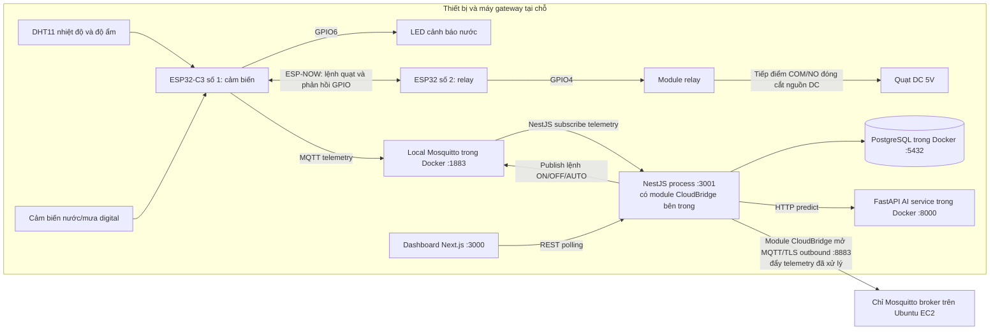

# Kiến trúc hệ thống giám sát môi trường

## 1. Hệ thống làm gì?

Đây là đồ án giám sát nhiệt độ, độ ẩm và trạng thái cảm biến nước/mưa cho kho giấy. Hai ESP32 xử lý phần cảm biến và relay tại chỗ. MQTT chuyển dữ liệu từ thiết bị đến backend. Backend NestJS lưu dữ liệu, đánh giá quy tắc cảnh báo, gọi dịch vụ AI và cung cấp API cho dashboard. Một broker Mosquitto trên EC2 nhận bản sao telemetry đã xử lý để có thể xem dữ liệu từ xa.

> DHT11 là cảm biến học tập/thử nghiệm, số đo có độ chính xác giới hạn và không thay thế thiết bị công nghiệp.

## 2. Sơ đồ tổng thể



Sơ đồ thể hiện hai hướng dữ liệu riêng: telemetry đi từ ESP32-1 lên backend; lệnh tay đi từ backend về ESP32-1. ESP32-1 giao tiếp trực tiếp với ESP32-2 bằng ESP-NOW. Dashboard không kết nối trực tiếp đến ESP32 hoặc MQTT broker.

### Thuật ngữ trên sơ đồ

- **Telemetry:** một bản ghi số đo/trạng thái do thiết bị gửi lên, ví dụ nhiệt độ, độ ẩm, lệnh quạt và trạng thái cảm biến nước.
- **Gateway:** trong đồ án này là máy tính local chạy NestJS và Docker, làm cầu nối giữa ESP32, cơ sở dữ liệu, AI và broker cloud.
- **API/REST:** giao diện HTTP mà dashboard gọi để đọc dữ liệu hoặc gửi lệnh; `:3001` là cổng NestJS.
- **MQTT:** giao thức nhắn tin publish/subscribe. Thiết bị publish vào topic; ứng dụng quan tâm topic đó subscribe để nhận.
- **TLS/MQTTS:** mã hóa và xác minh kết nối MQTT qua mạng; cloud broker đang dùng cổng 8883.
- **GPIO:** chân vào/ra số trên ESP32, ví dụ GPIO4 điều khiển relay node và GPIO6 điều khiển LED.
- **ESP-NOW:** liên kết radio trực tiếp giữa hai ESP32, không cần gửi gói qua MQTT broker.

## 3. Thiết bị và logic điều khiển

### ESP32-C3 số 1: cảm biến và bộ quyết định quạt

- Đọc DHT11 trên GPIO4 và ngõ ra digital của cảm biến nước/mưa trên GPIO5.
- Bật LED ngoài tại GPIO6 khi cảm biến nước báo ướt. Ngõ ra cảm biến hiện được cấu hình active-low.
- Tự quyết định lệnh quạt theo các ngưỡng dưới đây, trừ khi đang có lệnh tay từ dashboard.
- Phát bản tin ESP-NOW cho ESP32-2 khoảng mỗi 2 giây.
- Khi Wi-Fi và MQTT sẵn sàng, gửi telemetry lên broker Mosquitto local. Nếu Wi-Fi/MQTT mất, phần cảm biến và ESP-NOW vẫn có thể tiếp tục hoạt động.
- Có thể nhận lệnh `ON`, `OFF`, `AUTO` qua topic điều khiển MQTT local. Lệnh ON/OFF giữ nguyên trong RAM đến khi chọn AUTO hoặc board khởi động lại.

### ESP32 số 2: relay node

- Nhận lệnh quạt trực tiếp từ ESP32-1 bằng ESP-NOW; không nhận lệnh MQTT hay kết nối Internet.
- Điều khiển tín hiệu GPIO4 nối tới module relay. Firmware hiện đặt `RELAY_ACTIVE_LOW = false` (active-high).
- Gửi lại cho ESP32-1 mức GPIO đã đặt để ESP32-1 đưa vào telemetry với tên `relayActualStatus`.
- Phản hồi GPIO chỉ xác nhận firmware đã đặt output ở mức ON/OFF. Hệ thống không có cảm biến tiếp điểm hay tachometer, nên không thể xác nhận relay vật lý đã đóng hoặc quạt đang quay.
- Nếu không nhận bản tin ESP-NOW hợp lệ trong 10 giây, failsafe đặt relay về OFF. Đây là hành vi an toàn khi mất liên lạc, không phải bằng chứng về nguyên nhân mất gói.

Hai ESP32 cần dùng cùng kênh Wi-Fi/ESP-NOW. Khi cùng kết nối một access point, chúng theo kênh Wi-Fi của access point; khi không có Wi-Fi, firmware dùng kênh dự phòng 1.

### Quy tắc tự động bật/tắt quạt

| Trạng thái quạt hiện tại | Điều kiện đo được | Trạng thái tiếp theo |
| --- | --- | --- |
| OFF | Nhiệt độ ≥ 30°C **hoặc** độ ẩm ≥ 75% | ON |
| ON | Nhiệt độ ≤ 28°C **và** độ ẩm ≤ 70% | OFF |
| Bất kỳ | Chưa thỏa điều kiện chuyển trạng thái | Giữ trạng thái hiện tại |

Khoảng 30–28°C và 75–70% là hysteresis, giúp relay không bật/tắt liên tục khi số đo dao động gần ngưỡng. Vì vậy, 29°C không đủ để tắt quạt nếu trước đó quạt đang ON và độ ẩm chưa xuống tới 70% hoặc thấp hơn.

Lệnh điều khiển tay ghi đè chế độ tự động:

- **Bật:** ESP32-1 đặt lệnh quạt ON.
- **Tắt:** ESP32-1 đặt lệnh quạt OFF, kể cả khi nhiệt độ/độ ẩm đang cao.
- **Tự động:** xóa ghi đè tay; cảm biến quyết định lại ở vòng xử lý kế tiếp. Nếu lúc đó nhiệt độ ≥30°C hoặc độ ẩm ≥75%, quạt bật lại.

## 4. ESP-NOW và MQTT khác nhau thế nào?

- **ESP-NOW** là liên kết radio trực tiếp giữa hai ESP32. Nó mang lệnh bật/tắt quạt từ ESP32-1 sang ESP32-2 và mang phản hồi mức GPIO từ ESP32-2 về ESP32-1. Gói này không đi qua Wi-Fi router, MQTT, NestJS hay Internet.
- **MQTT local** chạy qua Wi-Fi và broker Mosquitto trong Docker trên máy gateway. Nó chuyển telemetry từ ESP32-1 tới NestJS và chuyển lệnh dashboard từ NestJS tới ESP32-1.
- **MQTT cloud/TLS** là kết nối riêng từ NestJS tới broker Mosquitto trên EC2. Nó dùng để chuyển dữ liệu lên broker từ xa; hai ESP32 không kết nối trực tiếp tới broker cloud.

## 5. Backend: NestJS và CloudBridge

### NestJS API/gateway

NestJS là backend chính, thường chạy trên máy gateway ở cổng 3001. Nó kết nối broker local, PostgreSQL, dịch vụ AI và module CloudBridge. Các feature module chia trách nhiệm như sau:

- `mqtt`: kết nối Mosquitto local, subscribe telemetry, phân tích JSON và publish lệnh điều khiển.
- `telemetry`: xử lý từng reading; cập nhật thiết bị/heartbeat, gọi AI, lưu reading vào PostgreSQL, đánh giá automation và yêu cầu CloudBridge chuyển tiếp reading.
- `devices`: thông tin thiết bị và thời điểm telemetry cuối cùng. Telemetry cũng được xem là heartbeat.
- `automation` và `alerts`: so nhiệt độ/độ ẩm với ngưỡng cấu hình, tạo và lưu alert.
- `dashboard`: tạo dữ liệu tổng quan qua `GET /dashboard/overview`.
- `database`: lưu trữ bằng PostgreSQL qua TypeORM.

Khi nhận telemetry, thứ tự xử lý hiện tại là: cập nhật thông tin thiết bị → gọi AI → lưu reading → đánh giá ngưỡng alert → gửi reading đã lưu tới CloudBridge. Nếu AI không sẵn sàng, backend vẫn tiếp tục ghi telemetry với kết quả AI unavailable.

### CloudBridge là gì?

**CloudBridge không phải một ứng dụng hay server riêng.** Đây là một service/module nằm bên trong tiến trình NestJS. Nó mở một MQTT client thứ hai, kết nối từ NestJS tới broker Mosquitto trên EC2 qua TLS. Client MQTT local dùng để nhận telemetry và lệnh; client của CloudBridge dùng để publish dữ liệu lên broker cloud.

Khi một reading đã được backend lưu và đánh giá, CloudBridge đóng gói nó thành JSON có `schemaVersion`, `deviceId`, `gatewayId`, các số đo, relay command/feedback, trạng thái nước, thời điểm và kết quả AI, rồi publish lên topic cloud. CloudBridge cũng publish trạng thái `ONLINE` của gateway khi kết nối thành công. Hiện code chưa publish `OFFLINE` khi ứng dụng tắt có kiểm soát.

CloudBridge **không** điều khiển relay, **không** nhận lệnh từ dashboard, và **không** làm dashboard truy cập được từ Internet. Lệnh dashboard vẫn đi qua API → broker local → ESP32-1. Broker EC2 chỉ nhận bản sao telemetry đã qua backend.

### Lưu trữ và online/offline

- PostgreSQL trong Docker giữ lịch sử telemetry, trạng thái thiết bị và alerts.
- Backend dùng thời điểm nhận telemetry làm heartbeat. Mặc định file mẫu đánh dấu thiết bị offline khi không nhận telemetry trong 15 giây; cấu hình thật lấy từ biến môi trường.
- API phản hồi `queued: true` cho lệnh relay nghĩa là MQTT broker đã nhận publish theo QoS 1. Nó chưa xác nhận ESP32-1 đã xử lý hoặc relay đã đổi trạng thái. Dashboard cần chờ telemetry/relay feedback tiếp theo để quan sát kết quả.

## 6. Alert và AI

### Alert theo ngưỡng

- Backend tạo alert nhiệt độ khi reading đạt `TEMPERATURE_ALERT_THRESHOLD`.
- Backend tạo alert độ ẩm khi reading đạt `HUMIDITY_ALERT_THRESHOLD`.
- File `.env.example` mặc định là 35°C và 80% RH. `.env` cục bộ có thể đặt ngưỡng khác.
- Hiện mỗi reading vượt ngưỡng có thể tạo một alert mới; chưa có gộp lặp theo khoảng thời gian hoặc alert riêng theo lần relay đổi trạng thái.
- Các ngưỡng alert này độc lập với ngưỡng tự động bật/tắt quạt trên ESP32. Ví dụ, quạt có thể bật ở 30°C trong khi alert nhiệt độ chỉ xuất hiện tại ngưỡng cao hơn.
- Trạng thái phát hiện nước được gửi trong telemetry và đưa vào AI; `AutomationService` hiện chưa tạo alert rule riêng cho nước.

### AI anomaly detection

- NestJS gửi nhiệt độ, độ ẩm, waterDetected, relay state và thời gian đo đến endpoint `/predict` của FastAPI.
- Dịch vụ AI dùng Isolation Forest cùng baseline đã huấn luyện để đánh giá độ khác thường so với dữ liệu nền. Percentile là vị trí tương đối của điểm bất thường so với phân bố điểm validation của baseline; nó không phải phần trăm khả năng xảy ra sự cố.
- Dashboard hiển thị mức `normal`, `warning` (Watch) hoặc `critical` (Alert). Đây là đánh giá bất thường của model, khác với alert ngưỡng nhiệt độ/độ ẩm của backend.
- Nếu cảm biến báo có nước, AI hiện có thể trả mức critical theo quy tắc đặc biệt.
- AI chỉ phân tích và hiển thị; không ra lệnh relay. Relay vẫn do quy tắc cố định hoặc lệnh tay tác động ở ESP32-1.

## 7. Dashboard

Dashboard Next.js gọi REST API NestJS, chủ yếu là `GET /dashboard/overview`, theo chu kỳ polling. Nó hiển thị nhiệt độ, độ ẩm, lịch sử, trạng thái AI, alerts, online/offline, lệnh quạt và phản hồi GPIO relay.

Các nút Bật/Tắt/Tự động gọi `POST /devices/{deviceId}/control/relay`. API publish lệnh lên MQTT local; ESP32-1 nhận lệnh rồi chuyển trạng thái quạt qua ESP-NOW cho ESP32-2. Dashboard không publish MQTT trực tiếp và không thể xác nhận trạng thái relay chỉ từ HTTP response `queued`.

## 8. Hai MQTT broker và đường đi dữ liệu

1. **Local Mosquitto trong Docker, cổng 1883:** ESP32-1 gửi telemetry; NestJS subscribe. NestJS cũng publish lệnh điều khiển tới broker này để ESP32-1 nhận.
2. **Mosquitto trên Ubuntu EC2, hostname `mqtt.cloudbridge.id.vn`, cổng TLS 8883:** client CloudBridge bên trong NestJS publish telemetry đã xử lý và trạng thái gateway.

```text
Telemetry: ESP32-1 → broker local → NestJS xử lý/lưu → CloudBridge (module bên trong NestJS) → broker EC2
Lệnh tay:  Dashboard → HTTP API NestJS → broker local → ESP32-1 → ESP-NOW → ESP32-2 → relay → quạt DC
Phản hồi:  ESP32-2 → ESP-NOW → ESP32-1 → telemetry MQTT → NestJS → API → dashboard
```

ESP32 tiếp tục dùng broker local; không cần trỏ ESP32 ra Internet cho CloudBridge. Không nên mở cổng 1883 local ra Internet. Kết nối broker cloud dùng TLS với chứng chỉ cho `mqtt.cloudbridge.id.vn`.

## 9. Chạy môi trường phát triển

Tại thư mục gốc dự án:

```powershell
docker compose up -d
npm run dev
```

Docker Compose khởi động PostgreSQL, local Mosquitto và AI service. `npm run dev` chạy NestJS API và dashboard Next.js theo script monorepo. API đọc cấu hình trong `apps/api/.env`; không commit `.env` hoặc `secrets.h` chứa thông tin kết nối.

## 10. Giới hạn và lưu ý khi demo

- DHT11 phù hợp học tập/demo, không phải thiết bị đo công nghiệp.
- ESP-NOW failsafe cho biết relay node đã không nhận gói hợp lệ quá thời gian timeout; log một mình không xác định được nguyên nhân là nhiễu sóng, lệch kênh, nguồn hay ESP32-1 bị nghẽn.
- Dòng `Send: queued` chỉ nghĩa gói được xếp vào hàng gửi; cần xem log ESP32-2 để xác nhận nhận gói.
- Để điều khiển phần cứng bằng dashboard, cần nạp firmware sensor mới vào ESP32-1. Sửa code trong project không tự cập nhật firmware trên board.
- Dashboard deploy lên Vercel cần gọi được API NestJS từ Internet. `localhost` trên trình duyệt người dùng không trỏ về máy gateway.
- Mạch quạt demo sử dụng tải DC điện áp thấp 5V. Không dùng sơ đồ relay này để đóng cắt điện lưới 220V.
